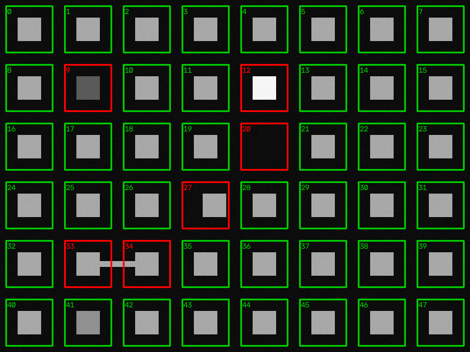

# spi-mini-cpp

SPI(Solder Paste Inspection, 솔더 페이스트 검사)를 공부하려고 C++로 만든 미니 과제입니다.

- 3D 높이맵을 직접 만들고 (정답을 아는 데이터), 패드마다 **면적·높이·부피·오프셋**을 재서 **OK/NG**를 판정합니다.
- 결함 5종(부족, 과다, 누락, 틀어짐, 브리지)과 아슬아슬하게 정상인 패드를 넣고, 판정이 정답과 맞는지 확인합니다.
- C++17, OpenCV, GoogleTest를 처음 제대로 써 보면서 만들었습니다.

## 파이프라인

```
합성 기판(높이맵, 1칸 = 10µm)
   │  패드 48개, 정상 높이 120µm + 결함 + 노이즈(σ)
   ▼
패드마다 검사창(패드 + 사방 20칸) ─▶ 30µm 넘는 칸만 세고 더하기 ─▶ 면적·높이·부피·오프셋
기판 전체 ─▶ 붙어 있는 솔더끼리 덩어리 나누기 ─▶ 덩어리가 패드 2개에 걸치면 브리지
   ▼
허용 범위와 비교 (면적·높이·부피 70~130%, 오프셋 60µm 이하) ─▶ OK / NG + 사유
```

- 무게중심은 `cv::moments`를 쓰지 않고 for문으로 x, y 평균을 직접 구했습니다.
- 브리지는 `cv::connectedComponents`로 찾습니다. 브리지 패드는 면적이 112.5%로 허용 범위 안이라 면적만으로는 못 잡고, 덩어리 검사로만 잡힙니다.

## 실행

```bash
cmake -S . -B build -DCMAKE_BUILD_TYPE=Release && cmake --build build
./build/spi_run      # 기판 만들기 + 검사 → heightmap.png, truth.csv, result.csv, result.png
./build/spi_eval     # 평가 (검출표, 노이즈 비교, 처리 시간)
cd build && ctest    # 테스트
```

## 결과



초록 = OK, 빨강 = NG. 9(부족), 12(과다), 20(누락), 27(틀어짐), 33·34(브리지)만 빨강이고, 41번(정상의 85%, 경계 정상)은 초록입니다.

```
NG 9: height 50%; volume 50%
NG 12: height 150%; volume 150%
NG 20: area 0%; height 0%; volume 0%
NG 27: offset 150um
NG 33: bridge
NG 34: bridge
정답과 다른 판정: 0개
```

## 평가 (`spi_eval`)

결함 위치는 고정하고 노이즈 시드만 바꾼 기판 20장씩 검사했습니다.

| 노이즈 σ | 결함 120개 중 놓침 | 정상 840개 중 가성불량 | 정상 패드 부피 오차 평균 |
|---|---|---|---|
| 0µm | 0 | 0 | 0%p |
| 2µm | 0 | 0 | 0.03%p |
| 10µm | 0 | 0 | 0.19%p |

- 결함 120개 = 부족·과다·누락·틀어짐 각 20개 + 브리지 40개(두 패드). 정상 840개 = 정상 820개 + 경계 정상(85%) 20개.
- σ 10µm까지는 판정이 무너지지 않았습니다. 바닥 노이즈가 30µm 기준선을 넘는 칸이 거의 없어서(3σ) 부피 오차만 조금 늘었습니다.
- σ 0은 노이즈가 없어서 20장이 모두 같은 기판입니다.
- 처리 시간: 기판 1장(패드 48개) 검사 100번 중앙값 **0.56 ms** (Mac mini M4, Release 빌드)

## 테스트 (GoogleTest, 11개)

| 테스트 | 확인하는 것 |
|---|---|
| `Setup.BlankIsAllZero` | 빈 이미지 크기와 값 |
| `Board.PadRectCorners` | 구석 패드 위치 (경계값) |
| `Board.NormalBoardHasAllPads` | 정상 기판의 칸 수와 높이 합 |
| `Board.DefectsChangeHeightAndTruth` | 결함이 기판과 정답지에 같이 들어가는지 |
| `Inspect.CleanBoardAllOk` | 결함 없는 기판은 전부 OK, 부피 100% |
| `Inspect.EachDefectGetsRightReason` | 결함마다 맞는 사유로 NG, 경계 정상은 OK |
| `Inspect.BlankBoardDoesNotCrash` | 솔더가 없는 기판에서도 안 죽고 전부 NG |
| `Measure.SingleBoxByHand` | 손으로 계산한 상자 1개(60µm) → 면적 100, 높이·부피 50 |
| `Judge.VolumeBoundary` | 69.9 / 70 / 130 / 130.1% (경계값 분석) |
| `Judge.OffsetBoundary` | 60 / 60.1µm |
| `Window.CornerWindowsInsideBoard` | 구석 패드의 검사창이 기판 밖으로 안 나가는지 |

## 실제 장비와 다른 점

- 높이맵을 바로 만들어서 씁니다. 실제 장비는 줄무늬 영상을 찍어서 높이를 복원해야 합니다.
- 그림자, 반사, 기판 휨, 캘리브레이션이 없습니다.
- 패드 위치를 이미 알고 있습니다 (실제로는 설계 데이터와 정렬해야 함).
- 허용 범위(70~130%, 60µm)는 예시값입니다. 실제로는 제품마다 정합니다.
- 노이즈는 정규분포 하나만 넣었습니다.

## AI 사용 범위

AI 코딩 도구로 단계별 코드 가이드와 리뷰를 받아 작성했습니다. 단계마다 빌드해서 정답 데이터와 테스트로 결과를 확인했습니다.
